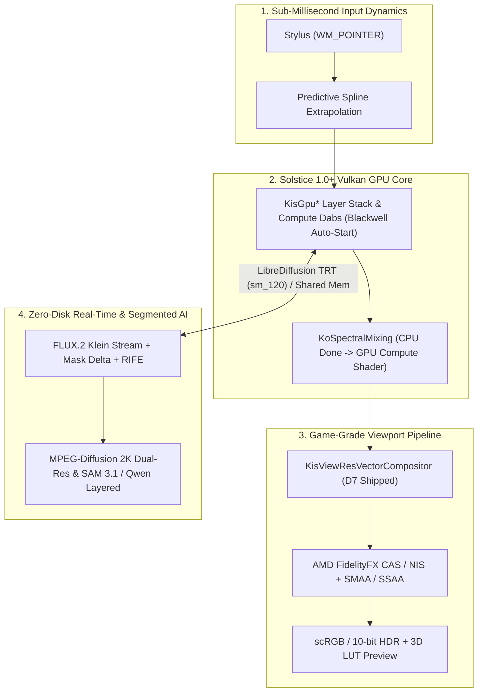

# Rendering & art-engine megaplan — agent reference

Status: **draft — pending user approval** (authored 2026-11-15).
Canonical plan for the Solstice foundation rebase, real-time AI canvas,
segmentation/layering, and art-engine work. Supersedes the external-worker
approach in `phase11-implementation-plan.md` §11.5 (native LookFX/Flarecore
port instead) and absorbs `plugin-integration-megaplan.md` Phase 14.1
(foundation rebase).

Source: `solstice_rendering_and_art_engine_production_plan.md` (external
planning export, 2026-11-15 — referenced by title/date only; it is not a
repo file). Companion ledger: `integration-ledger.md` (every external item,
its status, license and target location). DevOps backing: `devops.md` and
siblings.

## Decisions

User/source-plan decisions this plan executes under:

1. **Quick-win items are Integrated.** The #1 pass (backend/attention
   setup, `TAEF1/TAEF2` + WebSocket JPEG live preview, `FluxKVCache` on
   `flux2_4b`/`flux2_9b`, live resolution cap + optional
   `RTXVideoSuperResolution`, `NitroFusion2`/`TwinFlow` preset) is done and
   removed from the active backlog. `FluxKVCache` is verified wired in
   `plugins/python/ai_diffusion/backend/workflow.py` and
   `comfy_workflow.py`.
2. **NO TouchDesigner bridge.** `FluxRT-TD` is rejected. Real-time
   diffusion primitives (persistent encoder/reference cache, token-grid
   manual-mask delta regeneration, fixed-seed coherence, explicit small
   FlowMatch schedules, zero-disk frame transport, RIFE display
   multiplication) are ported natively via `librediffusion`.
3. **Selective `Solstice-1.1.1` rebase, never blind overwrite.** Upstream
   adds GPU Engine `1.0.0` and core painting features; our fork holds 19
   `libs/` + 15 `plugins/` files plus all of `plugins/python/` that
   upstream lacks. Preserve every fork-only module.
4. **100% built-in / zero-sidecar mandate.** Every adopted capability
   (ArtCraft crates, NightShift, Sentinel, LookFX/Flarecore, Lattice,
   PureRef, LUTs Manager, MoshDither, creative-suite concepts) is compiled
   or embedded natively in Solstice — C++/Qt, Vulkan/GLSL compute, static
   Rust-to-C FFI, built-in Python plugins, a unified in-app `/mcp` HTTP
   server, bundled KTX2/asset packs. External `vectorcraft-cli`,
   `effectcraft-cli`, `pdfcraft-cli`, external `krita-mcp/server.py`, and
   `phase11-implementation-plan.md` §11.5's external-worker filter are
   explicitly superseded. An existing local ComfyUI + `D:\models` install
   remains purely an optional heavyweight-checkpoint backend.
5. **Hosted CI = compile/sanity gate only.** CUDA/TensorRT builds, GPU
   e2e tests and release packaging run locally on the RTX 5090 machine
   (`sm_120`). No self-hosted runner. See
   `wiki/decisions/local-gpu-builds.md` and `devops-ci.md`.
6. **Ledger-driven tracking.** Every external item's status lives in
   `integration-ledger.md`; this document holds the roadmap and rationale.

## Anchor: what Solstice already provides

- `libs/gpu/` (`kritagpu`, Vulkan 1.3 compute, GLSL->glslc at build time),
  `libs/image/gpu/` (`KisGpuProjectionCompositor`, `KisGpuMergeBatch`, GPU
  tile backend), `KisGpu*` layer stack, `KisGpuPerspectivePass` +
  `perspective_transform.comp` + `KisGpuPerspectiveWorker`.
- `plugins/visionml` — native vision.cpp runtime (CPU or Vulkan):
  MobileSAM, MI-GAN Smart Fill, BiRefNet background removal, SmartMatting
  lasso, DepthMapFilter, ESRGANFilter. GGUF drop-in under
  `resources/visionml/models/{sam,migan,birefnet,depthanything,esrgan}`.
- `plugins/python/ai_diffusion` — 21 architectures (`flux3`, `qwen2`,
  `qwen_l`, etc.), LiveWorkspace backend, `FluxKVCache`, TAEF preview.
- `plugins/python/kritamcp` — in-app HTTP bridge `127.0.0.1:5678`, 63
  actions (`ai_*`, viewport, layers, selections, `trigger_action`,
  `screenshot`, `show_docker`), bearer auth, `/health` + `/info`.
- `tests/e2e/` — 32 tests driving real `solstice.exe` through the bridge.
- `KoSpectralMixing`/`KoCompositeOpPigment` — CPU spectral pigment mixing
  (GPU kernel is a Phase 5 item).
- `KisViewResVectorCompositor` (D7) — view-resolution vector display.
- `libs/ui/KisBrushStrokeLayer.*` — recorded strokes + `renderStrokes`.
- `.github/workflows/windows-build.yml` + dependency lock/mirror —
  reproducible Windows x64 packaging.
- `plugins/python/` vendoring lane — `install_pykrita_plugin` precedent.
- Trace to Vector Layer, `kis_svg_export`, AI Generative Fill,
  FramePainter (`ai_drag`), Qwen Edit, IC-Light, SeedVR2 upscale.

## Upstream evaluation: `Solstice-1.1.1` (`ac468d9`) vs fork (`deb3ebd6`)

| Area | Upstream-only additions | Fork-only additions | Verdict |
| --- | --- | --- | --- |
| `libs/` (72 upstream-only, 19 fork-only, ~4330 modified) | GPU Engine `1.0.0`: `KisGpuColorTransformPass`, `KisGpuCoveragePass`, `KisGpuShiftedCopyPass`, `KisGpuStrokeStylePass`, Blackwell auto-start on RGBA16F/32F; `KisClipStackLayer` (PS-style Clipping Masks + PSD/KRA round-trip) | `KisGpuPerspectivePass` + worker + `perspective_transform.comp`; `KoSpectralMixing` + `KoCompositeOpPigment` + `TestKoSpectralMixing`; `kis_view_res_vector_compositor` + decoration | **Selective merge** — upstream passes kill 64px Move Tool CPU fallbacks and add Clipping Masks; fork files are self-contained and carry forward. |
| `plugins/` (194 upstream-only, 15 fork-only, ~3357 modified) | `filters/solsticeeffects/` (12 effects + GPU Color Reference), G'MIC-Qt 3.7.4.1 (691 offline filters), `compositiondocker/CompositionDocumentState` (Layer Comps + per-comp Fast Image Export), `quickaccess` gestures, `through_layer_eraser`, `remove_dust`, `extensions/testcontrol` (C++ MCP test control) | `impex/svg/kis_svg_export.*`, `plugins/visionml` (SmartMattingTool, DepthMapFilter, ESRGANFilter, SegmentationMatteUtils, VisionMLMatteTest), `plugins/python/` (`ai_diffusion`, `kritamcp`, 10 PyQt6-shimmed plugins) | **Selective merge + conflict check** — adopt effects/tools/dockers; reconcile `testcontrol` with `kritamcp` so ports/tools never collide; `solsticeeffects` overlaps/complements Phase 5 LookFX. |
| `krita/` (6 upstream-only, 0 fork-only) | Icons: `clipping-enabled`, `remove_dust`, `through_layer_eraser` | — | **Adopt cleanly**. |
| Bundled VisionML GGUFs (in `Solstice-1.1.1-windows-x64`) | `BiRefNet-lite-F16.gguf` (84.54 MiB), `MIGAN-512-places2-F16.gguf` (14.07 MiB), `MobileSAM-F16.gguf` (25.65 MiB) | Missing from `D:\krita\share\krita\visionml\models` and `%APPDATA%\krita\visionml\models` | **Immediate copy** — Phase 1, no rebuild. |

**Corrections from the verified inventory (2026-11-15,
`docs/agent/foundation-rebase-inventory.md` — supersedes this table where
they disagree):** Solstice-1.1.1 is a newer release of *this same
project*, not upstream Krita — the merge is divergence-repair. Of the
~13,700 differing files only **426 are real content diffs** (~97% is
CRLF-vs-LF noise; normalize EOL first). No merge base exists, so these
are manual hunk merges, not a 3-way. Corrected counts: 203 upstream-only
plugins (not 194); `testcontrol` = 27 tools (not 26); `visionml` exists
upstream (12 files fork-only); `plugins/python` is shared. Merge order +
hard gates live in the inventory doc.

## Downloads audit -> integration routing

| Item (`C:\Users\richk\Downloads`) | Verdict | Ledger row |
| --- | --- | --- |
| `librediffusion-main.zip` | **INTEGRATE P1** — replaces FluxRT-TD; in-process C++ CUDA/TRT `sm_120` lib | `librediffusion` |
| `Solstice-1.1.1` + `-windows-x64-ac468d986539` | **INTEGRATE** — selective rebase + immediate GGUF copy | `Solstice-1.1.1 upstream snapshot` |
| `ComfyUI_MPEG_Diffusion_Suite` | **INTEGRATE P2** — 4 nodes for 2K dual-res idle refinement | `ComfyUI-MPEG-Diffusion` |
| `PixelAlchemist_v1.4.5` | Reference only — JSON preset params as creative reference | tally Reference row |
| `Wicked Engine` | Reference only — consult Vulkan HDR/CAS/SMAA/LUT shaders | tally Reference row |
| `glitchVids` | Asset only — optional CC BY 4.0 overlay test media (attribution) | tally Skip row |
| `S4W-Scanlines v1.4` | Skip — emulator bezel injector | tally Skip row |
| `Tiny-Consequences-main` | Skip — unrelated web game | tally Skip row |
| `Night Shift Setup 2.5.0.exe` | Superseded by built-in port (§7D pack) | `NightShift desktop pack` |
| `Paradoxal Creamation 5.1.7z` | Skip — password-encrypted archive, unverified | tally Skip row |

## Architecture decisions

1. **Selective rebase mechanics.** Work upstream `1.1.1` in as patches by
   subsystem (`libs/gpu` passes, `libs/image` clip stack, `plugins/filters`,
   `plugins/dockers`, `plugins/extensions/testcontrol`, `krita/` icons);
   never overwrite the fork-only list (megaplan "Upstream evaluation"
   column 3 + `feature-inventory.md`). Reconcile Qt5/Qt6 under the
   `BUILD_WITH_QT6` flag as each subsystem lands. Update
   `feature-inventory.md` for every upstream-file touch point added.
2. **Unified in-process `/mcp`.** Merge upstream's C++
   `TestControlMcpServer` (HTTP `/mcp` JSON-RPC 2.0, 26 tools:
   `session_info`, `document_*`, `input_stroke`, `canvas_capture`,
   `query_*`, `gpu_fault`, `brush_set`, `layer_activate`, `ui_*`,
   `docker_show`; env `SOLSTICE_TEST_CONTROL_PORT/TOKEN/ROOT`) with
   `kritamcp`'s 63 actions plus new `showa_*`, `blockout_*`, `capture_at`
   sweep actions — one endpoint served by `solstice.exe`. The external
   `krita-mcp/server.py` sidecar is retired. Port/tool collisions are
   reconciled during Phase 2 (`kritamcp` on :5678, testcontrol env-driven).
3. **Static C-FFI for Rust crates.** `MIT OR Apache-2.0` storytold crates
   compile to static libs via `cbindgen` and link into C++ plugins. No
   `egui`, no `-cli` sidecars. Shader logic is ported clean-room
   `.wgsl`->GLSL into the `kritagpu` glslc build path.
4. **Zero-copy frame transport.** `LibreDiffusion` TensorRT/CUDA textures
   reach the viewport via the Dawn `LatticeSharedImage` Vulkan<->D3D11 NT
   shared-handle pattern — no CPU round-trips.
5. **Model/asset distribution policy.** Bundled base GGUFs (SAM/MIGAN/
   BiRefNet-lite, ~124 MiB) ship inside the package; heavyweight stacks
   (`D:\models`, `D:\wildcards`, `D:\models\LUTs`, `D:\models\Poses`) are
   auto-discovered when present and documented as optional local roots —
   never required downloads (`devops-dependencies.md`).
6. **Single-installer AI bootstrap (user direction 2026-11-16).** One
   Solstice installer must deliver a working AI stack with no separate
   software installs: a managed ComfyUI backend (the ai_diffusion managed-
   server flow generalized into a first-run/component step), model and
   LoRA management UI over a shared catalog root, and the bundled base
   GGUFs of item 5. Downloading remains user-initiated/explicit (no silent
   network fetches); heavyweight stacks still auto-discover when present.
   Tracking doc to be split out of `devops-release.md` when scheduled —
   the packaged-installer seam already exists in
   `packaging/windows/package-complete.py` + `package-local.ps1`.

   **Component design** (verified against the working dev layout):

   | Component | Size | Ship mode | Notes |
   |---|---|---|---|
   | Solstice core | ~1.5 GB | in installer | app + plugins + base GGUFs |
   | ComfyUI managed server | ~2.5 GB | in installer | pinned ComfyUI + custom nodes + venv; today's ai_diffusion managed flow already provisions it into `%LOCALAPPDATA%` — promote to a bundled payload with hash-locked manifest |
   | `librediffusion.dll` + TRT/CUDA runtime | ~2.3 GB | optional component | TRT 11 runtime DLLs + `clip_tokenizer_c.dll`; gated on CUDA-capable GPU detect |
   | klein engine bundle | ~14.2 GB | post-install download | `transformer_bf16`, `qwen3_encoder`, `vae_*`, `rife` plans + `tokenizer.json` + `bn_*.bin` + `bundle.json`; `ampere_plus` builds are portable across SM 8.0+ |
   | Model/LoRA catalog | user-sized | post-install download | managed under a shared catalog root (`D:\models` auto-discovered; default `%LOCALAPPDATA%\Solstice\models`); per-model license shown before download; gated/uncleared weights never shipped |

   **First-run flow**: installer → detect GPU → optional components checked →
   first launch writes `settings.json` (`live_engine`, `native_engine_dir`,
   catalog root) → model manager offers the starter pack (klein bundle,
   SDXL base, recommended LoRAs) with resumable downloads + per-item
   license/consent → no restart needed to switch engines (ComfyUI stays
   the universal fallback for arbitrary LoRA/ControlNet graphs).

   **Open decisions**: engine bundles ship as installer components vs
   post-install downloads (14 GB argues download); per-user GPU builds
   (`same_cc`) vs shipped `ampere_plus` (portable, chosen); where the
   FP8 `speed` variant lands once calibration goldens exist; offline
   mirror layout for air-gapped installs.
7. **License boundary.** Only `MIT OR Apache-2.0` / MIT / CC-asset code
   enters the tree (GPLv3-compatible). Proprietary products are concept
   mines only — the zero-copy list is in `integration-ledger.md`. Mixbox
   is CC BY-NC — do not include (phase11 precedent).

## Deep-dive: real-time canvas (two native tiers)

**Tier 1 — in-process `librediffusion` stream engine** (`FLUX.2-klein-4B`
streaming, `SDXL Turbo` ~26 fps @1024², `SD Turbo` ~96 fps @512² on RTX
5090, `SDXS`, GaParmar img2img-turbo, ControlNet/IP-Adapter, RIFE):
- `librediffusion_flux2_stream_set_prompt()` — Qwen3 hidden-state cache,
  re-encode only on string change.
- `set_reference()`/`frame_cached()` — reference VAE encode separated
  from the denoise+decode tick; static canvases iterate at zero
  VAE-encode cost.
- `set_mask()` — RGBA host mask (white=regenerate) area-averaged onto the
  `Th x Tw` packed token grid; `latents = mask*generated + (1-mask)*noised_ref`
  every denoise step.
- `set_schedule()` — compact FlowMatch sigmas (`{1.0,0.64}` 2-step,
  `{1.0}` 1-step) + fixed seed 52 for frame-to-frame coherence.
- Integration: link as in-process C++ lib; selectable as
  `"Live Engine: Native TRT"` in `ai_diffusion` LiveWorkspace; ComfyUI
  WebSocket/TAEF remains the fallback for arbitrary LoRA stacks.

**Tier 2 — idle 2K dual-res refinement** (`ComfyUI-MPEG-Diffusion`):
`MPEGSaliencyProbe` -> `MPEGDualResAttentionPatcher` +
`MPEGTokenUpscaler` -> refine KSampler -> `MPEGSeamMerger` (2D
raised-cosine Hann blend + transition-band variance lock) after brush
pauses or base 1K generations -> seam-free 2K detail.

## Deep-dive: segmentation, matting & layered diffusion

**Disconnected silos to wire** (verified in source plan):
- `plugins/visionml/VisionML.cpp` hardcodes `sam/MobileSAM-F16.gguf`,
  `migan/MIGAN-512-places2-F16.gguf`, `birefnet/BiRefNet-*-F16.gguf`,
  `depthanything/Depth-Anything-V2-Small-F16.gguf`,
  `esrgan/RealESRGAN_x4plus-F16.gguf` — model dirs currently missing;
  MobileSAM lacks text prompting and illustration matting.
- `Arch.qwen_l`: latent layers wired for `refine()` but not `generate()`;
  `layer_count_widget` exists in `ui/generation.py`.
- `resources.py` gates `supports_alpha` away from `flux2_4b`/`flux2_9b`/
  `flux3`; ComfyUI `sd.py` needs 4-channel support for
  `flux2_3_rgba_vae.safetensors`.
- `model.py` exits early on non-`generate` workflows, blocking
  `matte_output`/`vectorize_output` on edit/refine/inpaint/layered.
- On-disk ComfyUI already has `nodes_sam3.py`, `nodes_compositor.py`,
  `nodes_qwen.py`, `nodes_moge.py`, `nodes_sam3d_body.py`; `D:\models`
  already holds `sam3.1_multiplex_fp16`, `BiRefNet_toonout`,
  `BiRefNet-general`, `BiRefNet_lite-2K`, `BEN2_Base`, `RMBG-2.0`,
  `inspyrenet`, `qwen_image_2.1*_bf16`. Missing custom-node packs:
  `comfyui-sam3`, `comfyui-rmbg`, `comfyui-inpaint-cropandstitch`,
  `ComfyUI-DepthAnythingV3`, `ComfyUI-SAM3DBody`.

**Five workflows** (source plan §6.2, unchanged):
1. `SAM3_Detect` (comma-separated text, `individual_masks=True`) -> Krita
   Region groups with masks/bboxes -> feeds `format_flux3_layout_prompt`/
   `format_moss_layout_prompt` and crops Live Canvas updates to the
   clicked object. Edge refinement via `BiRefNet_toonout` (anime/ink) or
   `BEN2` (hair/smoke/glass).
2. Non-destructive `Qwen-Image-Layered` studio: `generate()` layer
   parity, 4/8-step Lightning presets beside 50-step quality, named
   Krita Group wrap, right-click recursive "Split Selected Element".
3. End-to-end 4-channel RGBA: `supports_alpha` for
   `flux2_4b`/`flux2_9b`/`flux3` + Qwen 2.1; `flux2_3_rgba_vae`,
   `extract_4b`/`extract_9b`, `flux3_klein_transparent_lora` — true alpha
   props/characters instead of post-hoc white-box removal.
4. Unlock post-process cutout/vectorize + context-clean inpainting
   (`ObjectClear` + `inpaint-cropandstitch` local full-res passes) feeding
   `Trace to Vector Layer` + `kritasvgexport`.
5. 3D structure & depth/pose rigging: `DepthAnythingV3` + `MoGe` +
   `SAM3DBody` into reference/control layers.

## Art-engine pillars

## External source audits (condensed)

- **ArtCraft crates** (`storytold/*`, `MIT OR Apache-2.0`; ledger entry
  "ArtCraft craft crates"): static C-FFI or clean-room WGSL ports only.
  `vectorcraft` (trace/pathops/affinity), `effectcraft` (32 `.wgsl` +
  `sam2`/`segment`/`lottie`/`psd`/`track`), `photocraft` (`WM_POINTER*`
  tablet + predictive spline reference), `lightcraft` (GPU BM3D +
  `nn_*` ops), `anicraft` (16x16 vector binning, XFL), `materialcraft`/
  `texturecraft` (DAG materials, UV paint, bake/trace), `filmcraft`
  (scopes, `lut.wgsl`, edit algebra), `craft-ai-integrations` (`rten` CPU
  SAM2.1/BEN2/ViTMatte + `candle` SAM3 — zero-PyTorch fallback),
  `craft-libs` (GainMap/JXL/PSD/KRA/ORA/Lottie/MaterialX/CMS).
  Reference-only: `figcraft`, `designcraft`, `soundcraft`, `cadcraft`,
  `font-preview-service`. Skip: `pdfcraft`, `deckcraft`, `artcraft`,
  `artcraftx`, `craft-anything`, `craft-extensions`, `craft-skills`,
  `FineTrainers-Conditioning`, `indd-utils`.
- **NightShift pack**: `showa/engine.py` 7-stage analog pipeline
  (TIMING->HANDHELD->FILM->PRINT->SIGNAL->CRT->CHROMA, `L=height/480`,
  deterministic PRNG, 9 presets); `blockout.py` pinhole 3D staging
  (mannequin rigs, floor plan, focal-length contact sheets); 44 + 137
  skills; `NODES.md` node-DAG (`source`, `generate`, `note`, `wires`,
  `@image`); `gpu-queue` VRAM guard. All ported native; the external
  installer is never required.
- **Sentinel** (v0.6.15): `shader_worker` TDR watchdog sandbox;
  `datamosh_pro`, `dither_mosh`, `blend2d`, `LaserTraceGpu`, `nvngx_vsr`,
  FP8/`sm120` TensorRT packs, 240 Hz decoupled param/MIDI clock,
  LFO/WASAPI envelopes, `capture_at` cartesian sweep. Clean-room ports.
- **Lattice** (`app.asar`): `LatticeSharedImage` Vulkan<->D3D11 NT-handle
  zero-copy; `panel_set` compact HUD (4-10 contextual controls);
  multi-aspect batch export queue; WGSL primitives (`solver`, `pbr`,
  `rig`, `destruction`, `erosion`, `cel`).
- **LookFX** (`Apache-2.0`) + **Flarecore** (`Apache-2.0`): 17 halftones,
  21 paper substrates, 37 print presets, Ben-Day screening, capillary
  bleed, CMYK separation; 41 flare presets / 182 elements, depth
  occlusion, linear-space. Native Vulkan `KisFilter`/`KisGeneratorLayer`
  + KTX2 assets. Supersedes phase11 §11.5.
- **PureRef + Eagle patterns**: pinboard docker, `WS_EX_TRANSPARENT`
  click-through ghost overlay (opacity slider, `Alt+G` value check,
  `Shift+H`/`V` flip, non-destructive crop, `S` color pick, auto-pack),
  native SQLite `.pur` 1.x/2.x importer (`E:\AI_Art\PureRefBoards\`),
  hex/tag Asset Vault docker.
- **Concept mines only**: `Stimma` (FastConformer speech-to-prompt + PNG/
  WebP/JPEG EXIF workflow provenance), `artcraft.exe` (pre-generation
  validation gate), `Optics` (halation/mist/deband/defringe), `CLIP
  STUDIO` (line-width pressure, 1/2/3-point rulers, panels/balloons),
  `Luminar`/`Colourlab`/`Topaz` (depth portrait relight, hero-shot
  matcher, autopilot diagnostics + non-destructive restore/upscale),
  `Rebelle 8` (wet capillary + impasto thickness -> phase11 territory).

## Phased roadmap

Each phase lists deliverables, repo touchpoints, DevOps gates and
verification. Status of every external item lives in
`integration-ledger.md`.

### Phase 1 — Immediate groundwork (no C++ rebuild needed)

Status **2026-11-15: code+assets complete; GUI/e2e verification pending.**

- [x] Copy the 3 VisionML GGUFs from `Solstice-1.1.1-windows-x64` ->
  `D:\krita\share\krita\visionml\models` and
  `%APPDATA%\krita\visionml\models` (creates both dirs). **Also copied to
  `%APPDATA%\Solstice` (the actual `userModels` root), the dev install
  `F:\krita-work\krita\_install`, and the packaged test app.** Byte sizes
  verified.
- [x] `plugins/python/ai_diffusion/model/model.py`: lift the
  `WorkflowKind.generate` early-return so `matte_output`/
  `vectorize_output` run on edit/refine/inpaint/layered results.
  Implemented as a `control_image`-only skip — all applied results
  post-process, intermediate control maps stay untouched.
- [x] `plugins/python/ai_diffusion/backend/workflow.py` +
  `ui/generation.py`: `qwen_l` `generate()` latent-layer parity +
  4/8-step Lightning presets. `generate()` now calls
  `setup_latent_layers`/`pack_latent_layers`; `model.py` keeps
  `WorkflowKind.generate` for `qwen_l` and wraps multi-layer results in a
  `[Layered]` group; presets use the Lightning LoRA filenames verified on
  `D:\models`.
- [x] `backend/resources.py`: `supports_alpha` expansion for
  `flux2_4b`/`flux2_9b`/`flux3` (+ ComfyUI `sd.py` 4-channel VAE support
  on the `D:\krita\ComfyUI` side). Plugin side done (`is_flux2`); ComfyUI
  side delivered as verified `docs/agent/comfyui-rgba-vae.patch` —
  `D:\krita\ComfyUI` is not a git checkout, apply manually.
- [x] Local asset auto-discovery: index `D:\wildcards`, `D:\models\Poses`,
  `D:\models\LUTs` when present (zero downloads). `local_assets.py`
  singleton + `__wildcard__` expansion wired into `eval_wildcards`;
  settings + env overrides; see `docs/agent/local-assets.md`.
- **Verify** (pending — needs a running Solstice): `python -m pytest
  tests/e2e -v` green (attach mode OK); SmartMatting/Smart
  Fill/BG-removal work against the copied GGUFs; matting on an `edit`
  result produces a cutout layer; `[Layered]` group on a qwen_l
  generate.

### Phase 2 — Foundation rebase & unified `/mcp`

Prerequisite doc: `foundation-rebase-inventory.md` (verified file-level
diffs, merge order, hard gates). The merge is ~426 manual hunk merges —
**normalize EOL first**, then zero-conflict absorbs, then libs/plugins in
dependency order. 46 uncommitted-dirty files collide with upstream diffs.

- Selective `1.1.1` merge per "Architecture decisions" #1 and the
  inventory's merge order: GPU Engine `1.0.0` passes, `Convert16`
  RGBA16F policy + `unverifiedDevice*` opt-in (the "Blackwell auto-start"),
  Clipping Masks (`KisClipStackLayer`), Through-Layer Eraser, Remove Dust,
  Layer Comps + Fast Export, `solsticeeffects` + G'MIC-Qt, QuickAccess
  gestures, `krita/` icons.
- Merge `TestControlMcpServer` (C++, `plugins/extensions/testcontrol`,
  **27 tools** — corrected) with `kritamcp` (**88 actions** — corrected
  from 63) behind one `/mcp` surface per `unified-mcp-design.md`
  (kritamcp fronts `:5678`, JSON-RPC dispatch, C++ tools loopback-proxied);
  add pre-generation validation gate (`artcraft.exe` UX concept) and
  `gpu-queue` RTX 5090 VRAM guard into `ai_generate`.
- **DevOps gates**: full local build passes; `windows-build.yml` CI run
  green on `main`; `feature-inventory.md` updated for all new upstream
  touch points.
- **Verify**: `ctest` for touched libs; `tests/e2e` green incl. any new
  `/mcp` smoke tests; conflict audit vs fork-only file list; Qt5/Qt6
  reconcile checklist per subsystem.

### Phase 3 — Real-time AI, SHOWA & staging studio

- Build `librediffusion` (CUDA/TRT `sm_120` engines: `FLUX.2-klein-4B`,
  `SDXL Turbo`, `RIFE`). **License correction (intake audit
  2026-11-15): the project is AGPLv3, not MIT — user accepted
  2026-11-15:** in-process link, combined binary is AGPLv3 (open source
  already; obligations: ship `LICENSE`, mark modifications, §13
  source-notice on `/mcp`). Requires TRT 11, CUTLASS
  submodule pin, MSVC build (llvm-mingw can't host nvcc). Dawn
  `LatticeSharedImage` NT-handle zero-copy into the viewport; `set_mask`
  token-grid live loop; `"Live Engine: Native TRT"` option with ComfyUI
  fallback.
- MPEG-Diffusion idle 2K dual-res refinement (4 nodes -> native path).
- `camera-blockout` 3D staging docker; SHOWA 7-stage analog/CRT filter
  (9 presets) as `KisFilter`/Vulkan shader + `showa_*`/`blockout_*`
  `/mcp` actions; Prompt/Skill DAG composer (44 NightShift skills +
  `@image` slots); `Stimma`-concept speech-to-prompt + PNG EXIF
  provenance.
- **DevOps gates**: `build-tools/toolchains/windows-dev.lock.json`
  satisfied (CUDA 13.x, TensorRT 10.x) — see `devops-environments.md`;
  local GPU build only.
- **Verify**: frame-coherence check (fixed seed, mask delta); live
  canvas latency numbers into `wiki/benchmarks/`; e2e `ai_*` tests
  still green on the ComfyUI fallback path.

### Phase 4 — Segmentation, vector v2, formats & reference vault

- `SAM3_Detect` -> Krita Region auto-split + `BiRefNet_toonout`/`BEN2`
  edge matting; 4-channel RGBA chain (`flux2_3_rgba_vae`,
  `extract_4b`/`extract_9b`, `flux3_klein_transparent_lora`, Qwen 2.1).
- Static C-FFI: `craft-ai-integrations` (`ai-engine-rten` CPU ONNX
  fallback) + `vectorcraft` (`trace` multi-color/centerline/gradient,
  `pathops`/`live_paint`, `craft-affinity` `.af` import).
- PureRef pinboard docker + `WS_EX_TRANSPARENT` ghost tracing overlay +
  SQLite `.pur` importer + Eagle-pattern hex/tag Asset Vault.
- CLIP STUDIO-concept tools: vector line-width pressure reshaping,
  1/2/3-point perspective rulers w/ brush snap, comic panel divider +
  balloons.
- **DevOps gates**: Rust stable + `cbindgen` in `windows-dev.lock.json`.
- **Verify**: C-FFI unit tests (`kis_add_tests` in the new modules);
  `.af` round-trip on sample files; `.pur` import against real boards;
  e2e green.

### Phase 5 — Art-engine polish & live pipeline

- Viewport: `CAS`/`NIS` + `SMAA`/`SSAA`, `photocraft-tablet`
  `WM_POINTER*` + predictive spline; `KoSpectralMixing` GPU compute;
  Rebelle-concept wet/impasto (ties into `phase11-implementation-plan.md`
  11.2).
- LookFX + Flarecore native Vulkan (KTX2 asset packs); EffectCraft
  `inpaint.wgsl` (PatchMatch content-aware fill), `lightcraft` `bm3d`,
  `filmcraft-scopes` + tetrahedral `lut.wgsl`; Look Engine: 2D LUT atlas
  browser, split wipe, `D:\models\LUTs` auto-scan (10,383 `.cube`).
- Sentinel patterns: TDR shader sandbox, `capture_at` sweep,
  `datamosh_pro`/`dither_mosh` + `moshdither-studio` dithering, Optics-
  concept halation/deband, Luminar-concept depth relight.
- Lattice patterns: `panel_set` HUD, multi-aspect batch export,
  `solver`/`rig` WGSL-stdlib primitives; `anicraft`/`filmcraft`/
  `craft-libs` formats (GainMap/JXL/Lottie/PSD); `materialcraft`/
  `texturecraft` UV surface paint; `spark` GLSL.
- **Verify**: shader TDR-sandbox soak; benchmark pages; multi-aspect
  export e2e; full `tests/e2e` + affected `ctest` green.

## Risk register

| Risk | Mitigation |
| --- | --- |
| KDE registry prunes pinned deps (happened 2026-10-13) | Mirror + weekly `dependency-check.yml` already in place; refresh procedure in `github-actions.md`. |
| `1.1.1` merge collides with 19+15 fork-only files | Fork-only list is the merge checklist; `feature-inventory.md` tracks new touch points; subsystem-by-subsystem patches, never bulk copy. |
| CUDA/TRT toolchain drift on the single build machine | `windows-dev.lock.json` pins versions; `check-local-toolchains.py` verifies before Phase 3 work. |
| Qt5/Qt6 reconcile during rebase | `BUILD_WITH_QT6` per-subsystem checklist; `plugins/python` PyQt6 shim precedent. |
| License contamination | Zero-copy proprietary list in ledger; only `MIT OR Apache-2.0`/MIT code enters tree; brand assets excluded; CC BY-NC (mixbox) barred by phase11 precedent. **Found 2026-11-15:** `librediffusion` is AGPLv3 — resolved same day (user decision): in-process link, combined binary AGPLv3; obligations recorded in the ledger (ship `LICENSE`, mark modifications, §13 source-notice on `/mcp`). |
| Model distribution size | Bundled base GGUFs ~124 MiB only; heavyweight stacks auto-discovered locally — no runtime downloads (zero-sidecar). |
| Single-GPU contention (live engine + painting + gen jobs) | `gpu-queue` VRAM guard embedded in `ai_generate` (Phase 2). |
| `Solstice-1.1.1` divergence grows | Ledger re-check cadence; this plan is the merge contract — no further upstream pulls beyond `ac468d9` without a new evaluation. |

## Progress tracking

- Status changes land in `integration-ledger.md` + `wiki/log.md`.
- Phase status edits go in this document's Status header.
- Conflicts: `stabilization-plan.md` wins on open items until merged back
  (repo rule). `phase11-implementation-plan.md` remains canonical for
  11.1-11.4 (pigment, wet media, parametric strokes, docker QoL); its
  §11.5 external-worker tier is superseded by Phase 5 here.
- Website/release implications follow `devops-release.md` — a phase that
  ships user-visible features rides the normal release runbook.
